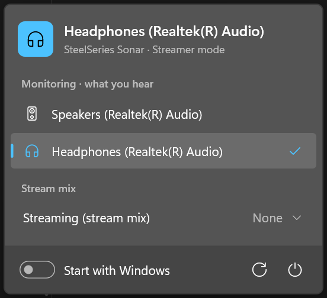

# Audio-Output-Device-Switcher

A small Windows tray app that shows where your audio is going (**headset**, **speakers** or **mixed**) and switches it from a Windows 11-style flyout.

It works on its own with the Windows default playback device. When [SteelSeries Sonar](https://steelseries.com/gg/sonar) is running, it uses Sonar's routing instead, so you can switch Sonar's "all output devices" or single channels straight from the taskbar.



## Features
- **Tray icon:** a speaker, a headset, or both when channels go to different devices. It follows the taskbar's light/dark theme and is drawn sharp at any DPI.
- **Flyout:** acrylic background, rounded corners and your Windows accent colour. Opens with a left or right click and closes when you click elsewhere or press Esc.
- **One-click switching:** pick a device to send all audio there.
- **SteelSeries Sonar support** (optional):
  - Classic mode: the device list routes Game, Chat, Media and Aux together. The **Channels** section sets each channel separately.
  - Streamer mode: the device list sets the *Monitoring* mix (what you hear). **Stream mix** sets the Streaming output.
- **Without Sonar:** shows and switches the Windows default playback device.
- **Start with Windows** switch, in a single ~1.3 MB exe with no installer and no runtime to install.

## Download
Get `audio-output-device-switcher.exe` from the [latest release](https://github.com/GerdonAbbink/Audio-Output-Device-Switcher/releases/latest) and run it.
On Windows 11 a new tray icon first lands in the overflow (**^**) area. Drag it onto the taskbar to keep it visible.

Requirements: Windows 10 or 11 (x64). The acrylic background needs Windows 11 22H2 or later; older versions get a solid background.

Releases are built from source by [GitHub Actions](.github/workflows/release.yml) and signed as described in the [Code signing policy](#code-signing-policy).

## Build
Requires [Rust](https://rustup.rs) (stable, MSVC toolchain) and the Visual Studio C++ build tools.
```powershell
cargo build --release
```
The exe ends up in `target\release\`. If linking fails with `LNK1104` because the project path is very long, point `CARGO_TARGET_DIR` at a shorter folder.

Developer options:
- `cargo run` (debug build) opens a console and logs every state change.
- `audio-output-device-switcher --dump-icons <dir>` writes all tray icons as PNGs.
- `audio-output-device-switcher --show-flyout <x> <y>` opens the flyout at a screen point and keeps it open, for screenshots.
- `cargo run --example make_icon` regenerates the exe icon (`assets/app.ico`). The version info shown in the exe's Properties dialog is set in `build.rs` and takes its version from `Cargo.toml`.

## How it works
**Headset or speakers:** a device counts as a headset if its name contains a word like *headphone*, *headset* or *Arctis*. Otherwise the app uses the Windows endpoint form factor (Headphones/Headset → headset, anything else → speakers).

**Windows default device:** devices are read through Core Audio (`IMMDeviceEnumerator`). Switching uses the undocumented `IPolicyConfig` interface, the same one other audio switchers use, for the console, multimedia and communications roles.

**SteelSeries Sonar:** Sonar has no official API. The app uses its local web API, as reverse-engineered by the community:
1. Read `ggEncryptedAddress` from `C:\ProgramData\SteelSeries\GG\coreProps.json`.
2. `GET https://<that>/subApps` (self-signed certificate) and take `subApps.sonar.metadata.webServerAddress`. The port changes every time GG restarts, so the app looks it up again whenever a call fails.
3. `GET /mode`, `GET /AudioDevices`, and `GET /ClassicRedirections` or `GET /StreamRedirections`, polled every 1.5 s.
4. Switch with `PUT /ClassicRedirections/{game|chat|media|aux}/deviceId/{id}` or `PUT /StreamRedirections/{monitoring|streaming}/deviceId/{id}`.

Because this API is unofficial, a SteelSeries GG update can break it. The app then falls back to the Windows default device.

## Source layout
| file | what it does |
|---|---|
| `src/main.rs` | tray icon, message loop, autostart |
| `src/flyout.rs` | the flyout window: layout, Direct2D/DirectWrite drawing, mouse handling, positioning |
| `src/worker.rs` | background polling and switch commands |
| `src/sonar.rs` | SteelSeries Sonar API client |
| `src/winaudio.rs` | Core Audio device list and form factor; default-device switching |
| `src/model.rs` | state, headset/speakers/mixed logic, tooltip |
| `src/icons.rs` | tray icons drawn with tiny-skia |

## Code signing policy
Free code signing provided by [SignPath.io](https://about.signpath.io), certificate by [SignPath Foundation](https://signpath.org).

- **Committers and reviewers:** [Gerdon Abbink](https://github.com/GerdonAbbink)
- **Approvers:** [Gerdon Abbink](https://github.com/GerdonAbbink)

Only release builds made by this repository's [release workflow](.github/workflows/release.yml) on GitHub-hosted runners are signed, and every signing request is approved by hand. Maintainer steps are in [docs/RELEASING.md](docs/RELEASING.md).

### Privacy policy
This program will not transfer any information to other networked systems unless specifically requested by the user or the person installing or operating it.

The app only talks to SteelSeries GG/Sonar on your own computer (`127.0.0.1`) to read and change audio routing. It has no telemetry, no update checks and no other network access.

## Credits
- Tray approach inspired by [Wireless-Device-Battery-Monitor](https://github.com/ZGMFX01A/Wireless-Device-Battery-Monitor). No code was copied.
- Sonar API details from [steelseries-sonar-py](https://github.com/Mark7888/steelseries-sonar-py) and [sonar-rev](https://github.com/wex/sonar-rev).

Not affiliated with or endorsed by SteelSeries. *SteelSeries* and *Sonar* are trademarks of their owners.

## License
[MIT](LICENSE) © 2026 Gerdon Abbink
